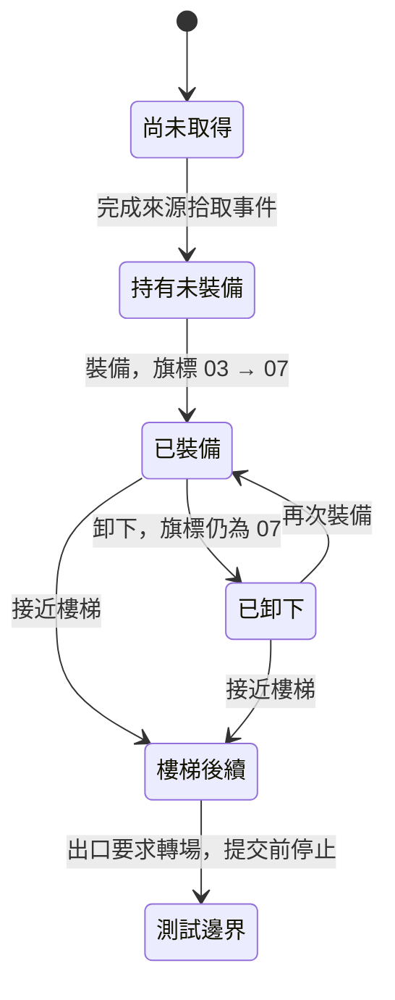

# MAP001 最小裝備流程：來源驗證

2026-10-25，基準 `9d613ae`。Q1 來源關卡通過，後續 PC 功能結果見 `EQUIPMENT_DELIVERY.md`。本輪依使用者要求不執行負載或效能測試。

## 正常操作結果

Start → Arms & Armor → Pike → Weapon → CIRRUS。原作使用 A／C 確認、B 返回；只有新按下執行操作。武器選單在持有時列出 CIRRUS 與 REMOVE；裝備後只剩 REMOVE。REMOVE 可以卸下，不能把「再次確認」誤認為重複裝備。

| 狀態 | 武器 060366B7 | 持有數量 060367CF | 攻擊 060366A0 | 劇情 06036938 |
|---|---:|---:|---:|---:|
| 尚未取得 | FF | 0 | 10 | 01 |
| 取得後 | FF | 1 | 10 | 03 |
| 裝備後 | 1B | 0 | 15 | 07 |
| 裝備再卸下 | FF | 1 | 10 | 07 |

劇情 bit 2 表示曾經裝備，不是目前武器槽的鏡像。`06017FE2..06017FEC` 只 OR 4；卸下分支 `06018108..0601813E` 歸還物品並清空武器，沒有清除此位元。攻擊以原有基礎值加裝備加成重算；物品 27 的來源記錄與加成表確認為 +5。取消、未持有時 REMOVE、長按確認不會額外消耗或授予。

| 來源操作 | PC 操作 | 一致性範圍 |
|---|---|---|
| Start → Arms & Armor → Pike → Weapon | E／裝備按鈕 | 省略選單導航；房內凍結是 PC 政策 |
| CIRRUS 選項的新按下 A／C | 裝備 Cirrus／Enter | 武器槽、持有數量、來源屬性重算與旗標 |
| REMOVE 選項的新按下 A／C | 卸下 Cirrus／Enter | 歸還物品、清空武器、不清除曾裝備旗標 |
| B 返回、不確認選項 | Esc／返回探索 | 不提交裝備狀態，不沿用輸入 |
| 正常走向樓梯及出口 | 相同邏輯移動輸入 | 腳本、角色、鏡頭逐更新；停止於跨場景提交前 |

樓梯腳本 `2F22 → 2F2F → 2FB2` 在 bit 2 已設時直接結束；人在觸發區內時可能每次更新重新執行，沒有額外對話或鎖定。裝備再卸下也能通過此分支。走到出口時，正常來源進入 `060AC458`；新 PC 入口須在該處寫入目的地之前停止，不能回復舊座標或偽造控制恢復。

## 證據

- 7 條序列，各三次，21 次完整重播的 CPU／VDP／RAM／畫面一致：首次裝備走樓梯、卸下走樓梯、再裝備走樓梯、未取得、持有後取消、長按裝備、切換選項後取消。
- 從同一初始狀態推演 3,685 次完整房內更新，2,846,456 項比較零差異；包含五名隊員的 260-byte 記錄、256-byte 物品數量表、劇情、角色、鏡頭、事件與必要物件。來源選單游標快取、座標備份及選單導航不是 PC runtime 狀態。
- 裝備操作由來源確認閘的選中項目推導語意請求，再比較提交與屬性重算後資料；不把後續 RAM 回填模型。
- 新路段新增 21 個實際查表格；僅核准通過模型比較的聯集。舊六包不變。
- 207 次穩定世界繪製、14,600,947 個世界像素零差異。原作選單淡入不屬 PC 精簡面板；穩定區間依來源色彩暫存器判斷。影子沿用既有省略，沒有新增玩家或家具遮罩。
- 完整渲染觀測器與正式路線 161 份共用採樣一致。5 項來源契約／操作故障測試通過。

本地入口：`reports/equipment/q1-acceptance.json`。原作圖像、RAM、快照與完整來源觀測留本地。原作選單返回時寫入的位置備份及選單游標另有來源例程，不宣稱 PC 精簡面板還原完整選單。

## 後續

Q2–Q5 的實作及驗收分別見階段文件與候選交付報告。沒有新增原作文字，沿用既有三段鎖定對話。前版 P5 尖峰確認、實際 GPU 120 FPS、影子、下一房間與 Stage B 整體仍未完成。
