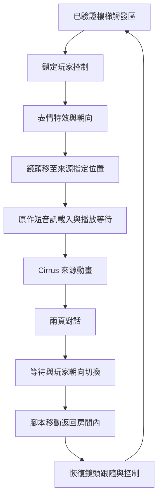

# MAP001 樓梯前 Cirrus 事件：來源工作紀錄

2026-10-15。D0、D1 已完成；D2–D4 尚未驗收。

## 已完成的前置交付

室內版 R5 已通過獨立 4K 600 秒測試、解壓後三解析度啟動及封裝核對。
提交 `e07b4de` 已同步 GitHub。室內 ZIP 保留；詳細數據見 `ROOM_DELIVERY.md`。

## 目前的來源發現

具名起點不變，使用原本鎖定的 Ymir 命令列擷取後端。新增事件採樣不修改舊快照鎖、四個資料包或室內入口。

- 樓梯腳本入口為 MAP001.TWN 檔案位移 `0x2F22`，執行位址 `0x260E2F1A`。
- 目前起點只證實條件位元組 `06036938 = 01` 下的分支；其他故事旗標分支拒絕使用。
- 事件鎖定控制後，先播放玩家表情特效及朝向動作，再移動鏡頭。
- 腳本請求原作 `IVENT041.AIF`。實際格式為單聲道 22,050 Hz、16-bit big-endian PCM，15,324 個樣本，約 0.695 秒。載入完成和播放開始是兩個不同等待條件。
- Cirrus 使用既有場景物件 6，識別值 `0030`，不是新增的一般角色物件。事件選擇動畫 5，交替使用圖像 46／71，最後停止。
- 兩頁文字後，玩家依來源改變朝向、以腳本速度返回原始座標 `(0x3320, 0x6940)`；鏡頭回到玩家跟隨後才恢復控制。
- 已觀察離開再進入時第二次執行事件，不能實作為只播放一次。
- 控制被腳本接管時，動畫選擇與游標先重設，但實際圖像快取會保留上一張行走姿勢；強制返回時，輸入移動旗標也可能為零而行走動畫仍播放。事件版必須依實際圖像／鏡射快取選外觀，不可直接套用自由行走選擇器或修改原作狀態來迎合它。

這是已觀察分支的流程，不能據此宣稱其他分支或整張地圖已還原。

## 文字對照

沿用既有語料的穩定 ID，不改譯文：

| ID | 繁中 |
|---|---|
| `map001_00afe2_p01` | 嗨，瞌睡蟲！你在做什麼，夢遊嗎？ |
| `map001_00afe2_p02` | 別丟下我一個人。我發誓要保護你，記得嗎？ |

英文來源及位移沿用本地 `work/analysis/dialogue_map001_cirrus_stair_descriptor.json`；正式事件包仍需綁定文字及來源雜湊。

## D1 驗收結果

- 六條正式序列：中央、上側、下側、再次進入、等待確認、長按確認；每條三次重播，共 18 次，所有同步 CPU／VDP 輸出一致。額外詳細與繪製觀測器的共用採樣檔案也與正式基準一致。
- 完整排程參照模型完成 6,679 次完整邏輯更新、6,685 個比較點及 1,174,565 項欄位比較，零差異。每個起點的半次更新及末端未完成更新分開處理。
- 131 個實際查表格全部包含在既有室內 613 格內，不新增允許範圍。
- 6,679 次世界繪製排序與 6,673 幅畫面、418,734,658 個世界像素比對通過，沒有未解釋差異。依實際 framebuffer 交換身分連結預測畫面，不以固定影格編號猜測。
- 原作 NBG3 對話底色依 VRAM2 的逐掃描線視窗表精確區分；原作文字、邊框及影子另外記錄。每條路線最初兩幅繼承畫面不納入新模型像素驗收。
- 2,004 次等待階段確認入口核對通過，共 12 次新按鍵被接受；長按不會連續翻頁。文字游標指向下一頁不代表下一頁已顯示。
- 完整模型只使用初始狀態、按鍵及明列的文字／音訊裝置回應，不讀取後續來源指令、角色或鏡頭狀態推動模型。原作裝置回應與 PC 介面政策分開驗證。
- 表情五張圖及 Cirrus 圖像 71 已解碼並納入世界畫面比對；來源素材保持本地。原作短音訊無損轉成 WAV，15,324 個 PCM 樣本回轉一致，實際 PC 播放仍屬 D3。
- 來源分支轉換為 5 段、35 條具名 PC 指令，保留位移、長度及雜湊。兩頁繁中來自既有鎖定語料。
- 14 項 Python 事件參照／契約測試通過。完整可重跑關卡為 `tools/summarize_event_source.py`，本地結果為 `reports/event/d1-acceptance.json`。

D1 通過範圍限於上述來源分支、排程、控制恢復、重觸發、角色／鏡頭及世界畫面。原作文字描繪改由核准高清介面替代；尚不能宣稱 PC 事件版完成。

## 下一階段入口

D2 使用具名 PC 指令建立獨立事件核心，對照 `generated/event/reference` 的六組初始狀態與輸入。後續來源狀態只能作比較，不能回填模型。D3 實作 PC 裝置回應、繁中介面與演出；D4 另做新版本回歸、實際畫面、獨立 4K 長測及封裝。

目前沒有 `MAP001-Event-Windows-x64.zip`。九項舊快照缺失測試、影子省略、相鄰場景及 Stage B 尚未完成的限制保持不變。
