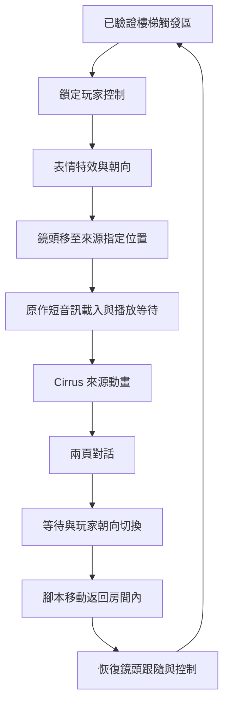

# MAP001 樓梯前 Cirrus 事件：來源工作紀錄

2026-10-15。D0 已完成；D1 正在驗證，尚未進入事件版交付。

## 已完成的前置交付

室內版 R5 已通過獨立 4K 600 秒測試、解壓後三解析度啟動及封裝核對。
提交 `e07b4de` 已同步 GitHub。室內 ZIP 保留；詳細數據見 `ROOM_DELIVERY.md`。

## 目前的來源發現

具名起點不變，使用原本鎖定的 Ymir 命令列擷取後端。新增事件採樣不修改舊快照鎖、四個資料包或室內入口。

- 樓梯腳本入口為 MAP001.TWN 檔案位移 `0x2F22`，執行位址 `0x260E2F1A`。
- 目前起點只證實條件位元組 `06036938 = 01` 下的分支；其他故事旗標分支拒絕使用。
- 事件鎖定控制後，先播放玩家表情特效及朝向動作，再移動鏡頭。
- 腳本請求原作 `IVENT041.AIF`。實際格式為單聲道 22,050 Hz、16-bit big-endian PCM，15,324 個樣本，約 0.695 秒。載入完成和播放開始是兩個不同等待條件。
- Cirrus 使用既有場景物件 6，識別值 `0030`，不是新增的一般角色物件。事件選擇動畫 5，交替使用圖像 46／71，最後停止。
- 兩頁文字後，玩家依來源改變朝向、以腳本速度返回原始座標 `(0x3320, 0x6940)`；鏡頭回到玩家跟隨後才恢復控制。
- 已觀察離開再進入時第二次執行事件，不能實作為只播放一次。

這是已觀察分支的流程，不能據此宣稱其他分支或整張地圖已還原。

## 文字對照

沿用既有語料的穩定 ID，不改譯文：

| ID | 繁中 |
|---|---|
| `map001_00afe2_p01` | 嗨，瞌睡蟲！你在做什麼，夢遊嗎？ |
| `map001_00afe2_p02` | 別丟下我一個人。我發誓要保護你，記得嗎？ |

英文來源及位移沿用本地 `work/analysis/dialogue_map001_cirrus_stair_descriptor.json`；正式事件包仍需綁定文字及來源雜湊。

## 驗證邊界

- 中央及上側路線各三次 CPU／VDP 同步重播已通過完整來源驗證，各 883 個模擬影格，零檔案差異。
- 玩家、鏡頭及表情特效元件已通過中央、上側、下側及再次進入路線的連續比較。元件驗證使用來源指令作輸入，不等於完整事件模型驗收。
- 新增完整排程參照模型後，中央、上側、下側及再次進入的詳細採樣，共 776,870 項比較零差異，涵蓋指令、玩家、鏡頭、Cirrus、場景裝飾物、表情、控制及事件槽。共有 4,422 個比較點，包含各起點的剩餘半次更新；每條擷取末端仍有一次更新未到完整結束點。
- 完整排程模型從初始狀態推演，不讀取後續來源指令或角色狀態來推動自身。原作文字視窗及資源裝置的回應仍是明列的外部輸入；PC 介面的輸入映射與裝置回應尚未驗收。
- 表情五張圖與 Cirrus 圖像 71 已從來源圖像記錄、紋理及色盤解碼，留在本地 `generated/event/source-sprites`。來源綁定通過不代表繪製排序或畫面驗收通過。
- 原作短音訊已無損轉成 WAV，15,324 個 PCM 樣本逐一回轉一致。這是資料轉換驗證，尚非播放驗收。
- 新增九項參照模型測試通過：來源變更、未知等待、缺少裝置輸入、等待到期順序、載入超時邊界、表情結束、強制移動落點、固定鏡頭及音訊樣本保真。
- 中央路線已完成 882 次世界繪製順序比較，零差異。使用核心 `06086FCA`／`06087050` 的命令緩衝區及完成提交證據連結模型狀態，不再固定扣兩個模擬影格。初始繼承畫面、原作文字介面及影子分開記錄；這仍不是 PC 像素或整體交付驗收。

## D1 尚待完成

1. 完成全部六條正式序列的三次重播驗證，以及詳細裝置／排程採樣的跨路線比較。
2. 將中央路線通過的繪製提交連結擴至其餘序列，核對實際顯示時點。固定取前兩個模擬影格的初步失敗證據保留，不作為最終規則。
3. 完成必要表情、Cirrus、玩家及家具的繪製順序和遮擋對照，明確區分來源對話框與世界畫面。
4. 凍結事件來源契約及文字／資源回應介面，之後才實作 Godot 事件包和高清對話入口。

目前沒有 `MAP001-Event-Windows-x64.zip`，也未宣告 D1、D2、D3 或 D4 通過。
九項舊快照缺失測試、影子省略、相鄰場景及 Stage B 尚未完成的限制保持不變。
