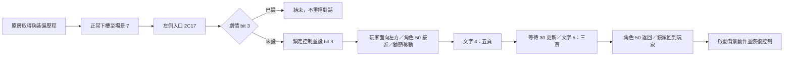

# MAP001 落點左側事件：來源研究

實作基準為 `70f836a7fbcc04fc46380437b7aaea23984ddc73`。L1 來源驗證已通過；此來源關卡不代表 Godot、畫面、套件或完整交付通過。依使用者要求，未執行負載、長循環、效能基準或實際 GPU FPS 測試。

## 已核對的主流程

場景 7 的左側接觸記錄位於 MAP001.TWN `0x109C`，入口 `0x2C17`。玩家進入區域後，原作先判斷劇情 byte `06036938` 的 bit 3；未設時進入 `0x2C26`，設過時走 `0x2C24` 結束。因此不能用「離開區域才可重新觸發」取代來源規則。

三種正式裝備歷程與輸入邊緣路線已由原房具名起點連續推演，比較玩家、角色資源 50、兩個鏡頭、八個場景物件、裝備、256-byte 物品表、260-byte 隊員資料及事件指令／等待狀態，沒有回填後續原作狀態。首次裝備、卸下、重裝三條各三次；邊緣／長按／連按組合三次；事件後卸下與重裝另三次。各組重播逐檔一致。

文字說話者為 **LAIA**；事件將資源 50 掛接至接近、返回與背景動作腳本，原作畫面可交叉核對。不依資源編號猜測人物名字。兩段文字對應鎖定語料 `map001_00b141`、`map001_00b2e2`，共八頁，已有可核對的繁中譯文。此主流程沒有新的音訊載入／播放指令；仍保留原先音樂請求與其既有未驗收限制。

完整重播在本場景恢復控制，沒有要求戰鬥、選單或再次轉場。角色後續背景腳本 `0x2CD6..0x2D04` 包含單軸移動、等待、動畫 7 與回跳，不能在對話結束後把角色凍結為一張圖。

## 分離的來源契約

- 原八包與入口不變。新的 `landing_event_source.py` 僅列出六段、46 條有界指令，不允許任意 Saturn 腳本執行。
- `landing_event_actor.py` 單獨處理資源 50。來源 `060AC034/060AC08C` 依 actor +08 bit 0 選取姿勢表；本角色使用四方向表，玩家使用另一張表。舊到達姿勢 profile 仍拒絕其他動畫。
- 角色事件槽依最低可用槽分配；接近時為槽 2，玩家短事件結束後，返回與背景動作可改用槽 1。不能把槽 2 永久等同此角色。
- 來源 `060A14DE` 鎖定控制時也設定主循環 phase 3。鏡頭固定／追蹤及速度恢復依事件指令推演。
- Python 模型接受來源按鍵與明列文字裝置 active 回應；不把影格時間、真實磁碟延遲或後續 actor／camera RAM 當成狀態輸入。

## 來源驗收與後續關卡

L1 報告鎖定於 `data/landing-event/source-lock.json`。正式三條各比較約四百萬欄位／位元組，輸入邊緣路線比較 4,833,417 項，零差異；46 條必要指令及八頁等待／確認順序均觀察到。事件後卸下、重裝各保持劇情 `0f`，完整隊員與物品表沒有額外變化。後續仍須通過 L2 第九包及 Godot 核心、L3 像素與顯示時序、L4 操作整合、L5 短程畫面與候選 ZIP。原作圖像、RAM、快照與完整採樣均留本地。

效能未驗收。舊快照缺失九項、影子省略、雙向往返、完整目的地與 Stage B 整體未完成繼續保留。
